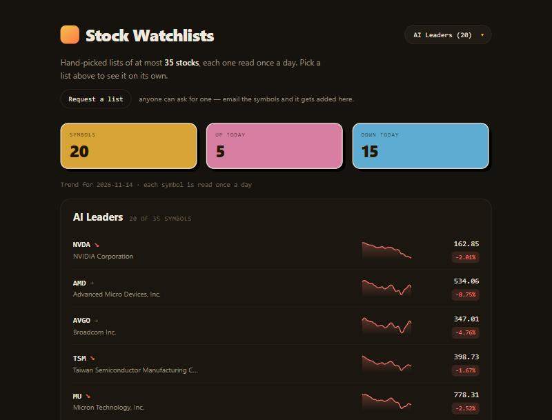

# Stock Watchlists

A small, self-hosted stock watchlist reader. Pick a list from the header, see
at most 35 symbols on one calm screen — price, daily change, trend and a
sparkline — and nothing else.

Lists are curated, not user-generated: they are defined in code and inserted on
startup, so the page itself has no create/edit/delete UI. Visitors ask for a
list by email and the owner adds it.



[](LICENSE)


## Why

Most watchlist apps want an account, push notifications and a feed. This one
renders one list, once a day, and gets out of the way. It is deliberately
read-only at the front end and cheap to run: each symbol costs exactly one API
call per day, which fits inside Twelve Data's free tier.

## How it works

```
browser ──► Gin ──► MongoDB ──► background worker ──► Twelve Data
            │         │                                   │
      static page   lists +                        one call per
      (no build)    cached quotes                  symbol per day
```

- **Curated lists** live in [`backend/controllers/watchlists/seed.go`](backend/controllers/watchlists/seed.go).
  On startup each one is inserted if a list of that name does not already
  exist, so edits made through the API survive a restart.
- **A background worker** runs on boot, every 30 minutes, and whenever a list
  changes. It resolves any typed entries, then fetches the daily series for
  each symbol that has no quote for today.
- **Quotes are cached per symbol per day** in MongoDB, so reloading the page
  costs nothing. A sliding-window limiter caps outgoing calls at 8 per minute
  (Twelve Data's free tier), reserving 2 for interactive symbol search.
- **Trend** is a 20-day simple moving average: above a rising average is
  `Uptrend`, below a falling one is `Downtrend`, anything else `Sideways`.

## Quick start

**Prerequisites:** Go 1.26+, MongoDB running locally, and a free
[Twelve Data](https://twelvedata.com/) API key.

```bash
git clone git@github.com:nivas-27/stock-reader.git
cd stock-reader/backend
```

```bash
cp .env.example .env
```

Put your key in `.env` as `TWELVE_DATA_API_KEY`, then:

```bash
go run .
```

Open <http://localhost:8080>. The `AI Leaders` list seeds itself on first boot;
prices fill in over the next few minutes as the worker works through the
rate limit.

Without MongoDB the server still starts and serves the page, but watchlists are
disabled and the page says so. Without an API key the lists render with no
prices.

## Configuration

All settings are environment variables, read from `backend/.env` or the real
environment. See [`backend/.env.example`](backend/.env.example).

| Variable | Default | Purpose |
| --- | --- | --- |
| `TWELVE_DATA_API_KEY` | — | Required for prices, trend and search |
| `MONGO_URI` | `mongodb://localhost:27017` | MongoDB connection string |
| `MONGO_DB` | `nivas_stock_reader` | Database name |
| `PORT` | `8080` | HTTP port |
| `TWELVE_DATA_PER_MINUTE` | `8` | Raise on a paid plan |
| `TWELVE_DATA_BASE_URL` | Twelve Data API | Point tests at a fake server |

`.env` is gitignored. Never commit real keys.

## Adding a watchlist

Lists are code, not data. Add an entry to `seedLists` in
[`backend/controllers/watchlists/seed.go`](backend/controllers/watchlists/seed.go)
and restart:

```go
{
    Name: "Clean Energy",
    Items: []models.ListItem{
        stock("ENPH", "Enphase Energy, Inc.", "NASDAQ"),
        stock("FSLR", "First Solar, Inc.", "NASDAQ"),
    },
},
```

Giving the exchange explicitly means no symbol-search credits are spent
resolving it. A list holds at most 35 symbols (`maxItemsPerList` in
`controller.go`); anything beyond that is reported on the page as
`<entry> (list is full)`.

To change where "Request a list" points, edit `REQUEST_EMAIL` at the top of
[`backend/web/watchlists.js`](backend/web/watchlists.js).

## HTTP API

| Method | Path | Purpose |
| --- | --- | --- |
| `GET` | `/api/lists` | Every list with today's quotes merged in |
| `POST` | `/api/lists` | Create a list |
| `PATCH` | `/api/lists/:id` | Rename, or clear "could not find" notes |
| `DELETE` | `/api/lists/:id` | Delete a list |
| `POST` | `/api/lists/:id/items` | Add one resolved instrument |
| `DELETE` | `/api/lists/:id/items` | Remove one, by `?symbol=&exchange=` |
| `POST` | `/api/lists/:id/entries` | Queue raw names/symbols to resolve |
| `GET` | `/api/search` | Symbol search, `?q=` |
| `GET` | `/ping` | Health check |

`GET /api/lists` never calls Twelve Data — it only reads what the worker has
already cached.

> **Security note.** The write endpoints are **unauthenticated**. The page does
> not call them, but anyone who can reach the server can. Keep the server on a
> trusted network, or put an authenticating reverse proxy in front of it before
> exposing it to the internet.

## Project layout

```
backend/
  main.go                     routes and startup
  configs/db/                 MongoDB connection and indexes
  configs/env/                .env loading
  controllers/watchlists/     handlers, seed lists, resolver, worker
  models/                     DB structs only
  utils/twelvedata/           API client and rate limiter
  web/                        the page: no build step, no dependencies
  controllers/kite*/          Kite/NSE code, kept but not routed
docs/                         screenshot
```

The Kite / NSE (Indian market) code and the older `web/index.html` dashboard
are still in the tree but are deliberately not wired up in `main.go`.

## Development

```bash
cd backend && go test ./...
```

The front end is three plain files — no bundler, no `node_modules`. Edit and
reload.

## Disclaimer

For information only. This is not investment advice, and prices may be delayed
or wrong. Do not make financial decisions based on it.

## License

[MIT](LICENSE) © nivas-27
